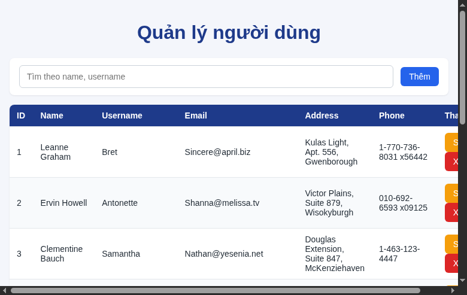
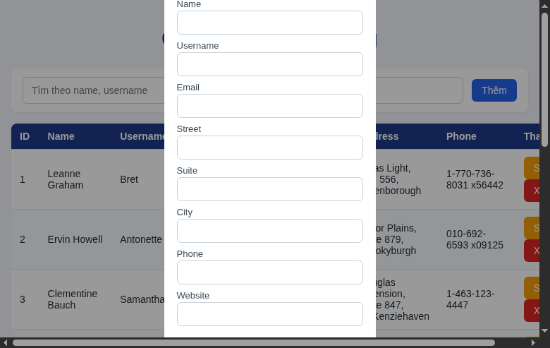
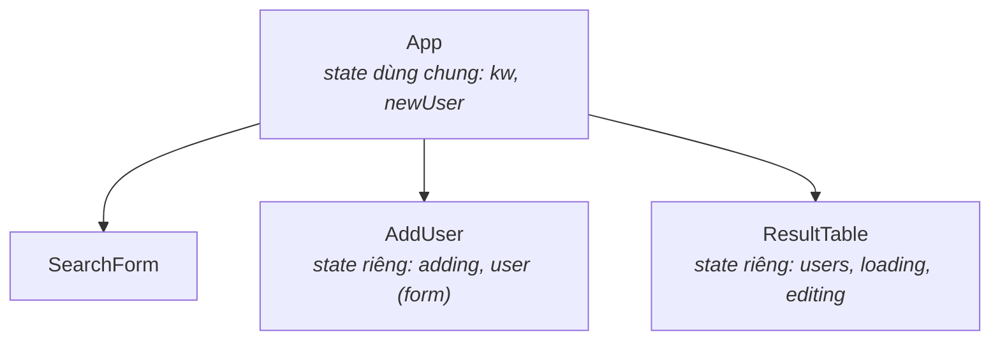
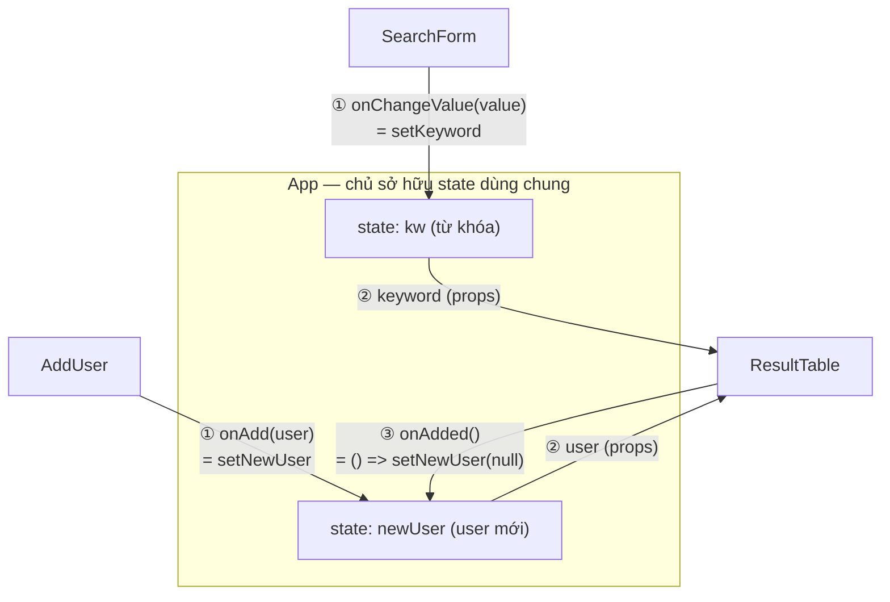

# Bài tập 6 — Ứng dụng React CRUD: Quản lý người dùng

Ứng dụng CRUD (Create – Read – Update – Delete) + tìm kiếm người dùng, xây dựng bằng
**React 18** (Functional Components + Hooks `useState`, `useEffect`) theo tài liệu
*“Ex. React-CRUD – 20261”*.

| File | Mô tả |
|------|-------|
| `index.html` | Toàn bộ ứng dụng — React 18 + ReactDOM + Babel qua CDN, code React viết trong `<script type="text/babel">` |
| `screenshot.png` | Ảnh chụp giao diện bảng người dùng |
| `screenshot-modal.png` | Ảnh chụp modal thêm/sửa người dùng |

- **Xem trực tiếp (GitHub Pages):** https://loegaire.github.io/it4409/bai6/
- **API dữ liệu:** `https://jsonplaceholder.typicode.com/users` (10 users, tải 1 lần khi mount bằng `useEffect([])`)




**Chạy local:** mở trực tiếp `index.html` bằng trình duyệt (cần Internet để load CDN + API),
hoặc:

```bash
python3 -m http.server 8081
# mở http://localhost:8081/bai6/index.html
```

---

## 1. Sơ đồ Component (Component Tree)



```
App                         ← gốc, render bằng ReactDOM.createRoot
├── SearchForm              ← ô nhập từ khóa tìm kiếm
├── AddUser                 ← nút "Thêm" + modal thêm người dùng (khi adding = true)
└── ResultTable             ← bảng danh sách + modal sửa (khi editing ≠ null)
```

| Component | State bên trong | Vai trò |
|-----------|-----------------|---------|
| **App** | `kw`, `newUser` | Quản lý state **dùng chung** và truyền xuống con qua props |
| **SearchForm** | *(không có)* | Nhận input tìm kiếm, gọi `onChangeValue` sau mỗi lần gõ |
| **AddUser** | `adding`, `user` | Form thêm người dùng mới (modal), gửi dữ liệu lên App qua `onAdd` |
| **ResultTable** | `users`, `loading`, `editing` | Tải API, lọc theo `keyword`, hiển thị bảng, xử lý sửa/xóa |

## 2. Sơ đồ luồng dữ liệu (State Lifting)



Luồng **tìm kiếm**: `SearchForm` → `App` → `ResultTable`

1. Người dùng gõ → `SearchForm` gọi prop `onChangeValue(value)` (chính là `setKeyword` của App);
2. `App` đổi state `kw` → re-render → truyền `kw` xuống `ResultTable` qua prop `keyword`;
3. `ResultTable` dùng `users.filter(...)` theo `keyword` rồi vẽ lại bảng.

Luồng **thêm người dùng**: `AddUser` → `App` → `ResultTable` → `App`

1. `AddUser` điền form xong gọi prop `onAdd(user)` (chính là `setNewUser`);
2. `App` lưu vào state `newUser` → truyền xuống `ResultTable` qua prop `user`;
3. `ResultTable` có `useEffect([user])`: thấy `user ≠ null` thì nối vào mảng `users`,
   rồi gọi `onAdded()` để App đặt lại `newUser = null` (tránh thêm lặp lần render sau).

### Vì sao `kw` và `newUser` đặt ở App mà không đặt ở SearchForm / AddUser?

- **Luồng dữ liệu trong React là một chiều (top-down)**: component chỉ truyền dữ liệu được
  xuống **con cháu** của nó qua props. Trong cây component, `SearchForm` và `ResultTable`
  là **anh em** (cùng cấp) — nếu `kw` nằm trong `SearchForm` thì `ResultTable` không bao giờ
  nhận được, vì không có cách nào truyền props ngang giữa hai anh em.
- **Điều kiện để hai component chia sẻ state**: state phải đặt ở **tổ tiên chung gần nhất**.
  Tổ tiên chung của cặp (`SearchForm`, `ResultTable`) và cặp (`AddUser`, `ResultTable`)
  đều là `App` → `kw` và `newUser` phải được "nâng" lên App. Đó chính là kỹ thuật
  **State Lifting** (nâng state lên).
- **State là private**: chỉ component sở hữu state mới được thay đổi nó. App truyền cả
  **hàm cập nhật** xuống con qua props (`setKeyword` → `onChangeValue`, `setNewUser` →
  `onAdd`) để component con *gián tiếp* thay đổi state của cha — dữ liệu vẫn chảy một chiều
  con → cha (gọi hàm) và cha → con (props).
- Lợi ích: **một nguồn dữ liệu duy nhất** (single source of truth). `ResultTable` không
  tự giữ từ khóa hay user mới mà chỉ nhận dữ liệu suy ra (derived) qua props — `kw`/`newUser`
  đổi là App tự re-render truyền giá trị mới xuống, mọi component luôn đồng bộ.

## 3. Bảng Props truyền từ App xuống các component con

| Component nhận | Prop | Kiểu | App truyền gì | Hướng & ý nghĩa |
|----------------|------|------|---------------|-----------------|
| `SearchForm` | `onChangeValue` | `function` | `setKeyword` | **Con → cha**: mỗi ký tự gõ vào gọi `onChangeValue(e.target.value)` để App cập nhật `kw` |
| `AddUser` | `onAdd` | `function` | `setNewUser` | **Con → cha**: bấm Thêm gọi `onAdd(user)` để App lưu người dùng mới vào `newUser` |
| `ResultTable` | `keyword` | `string` | `kw` (state) | **Cha → con**: từ khóa để `filter()` danh sách theo `name`/`username` |
| `ResultTable` | `user` | `object \| null` | `newUser` (state) | **Cha → con**: người dùng mới cần nối vào bảng; `null` = không có gì chờ xử lý |
| `ResultTable` | `onAdded` | `function` | `() => setNewUser(null)` | **Con → cha**: báo đã thêm xong để App reset `newUser` về `null`, tránh `useEffect([user])` thêm lặp |

Ngoài ra `ResultTable` còn truyền dữ liệu xuống chính DOM nó render — mỗi `<tr key={u.id}>`
trong `filteredUsers.map()` (props `key` giúp React nhận diện từng dòng).

## 4. Lỗi thực tế gặp phải khi code

### Lỗi 1 — Warning: thiếu `key` khi render danh sách

**Thông báo lỗi (console chụp thật từ trình duyệt):**

```
Warning: Each child in a list should have a unique "key" prop.
See https://reactjs.org/link/warning-keys for more information.

Check the render method of `ResultTable`.
    at tr
    at ResultTable (<anonymous>:180:23)
    at div
    at App (<anonymous>:31:31)
```

**Hiện tượng:** ứng dụng vẫn chạy được, nhưng mỗi lần render danh sách (cả khi gõ tìm kiếm)
console lại in cảnh báo này; React không có cách đối chiếu phần tử cũ – mới nên phải vẽ lại
toàn bộ các `<tr>`.

**Nguyên nhân:** dòng render danh sách viết là
`filteredUsers.map((u) => (<tr> ... </tr>))` — thiếu prop `key`. Khi render một mảng,
React bắt buộc mỗi phần tử phải có `key` **ổn định và duy nhất** để biết item nào
thêm/xóa/đổi chỗ (không dùng index vì index đổi khi lọc/xóa).

**Cách sửa:** thêm `key` bằng id của user:

```jsx
{filteredUsers.map((u) => (
  <tr key={u.id}> ... </tr>
))}
```

Kiểm chứng: sau khi sửa, console không còn warning nào từ React.

### Lỗi 2 — Modal “Thêm người dùng” không mở được (lỗi logic, im lặng)

**Hiện tượng sai (kiểm tra thật bằng DevTools):** bấm nút **Thêm** → modal chỉ *nhấp nháy*
rồi biến mất ngay lập tức, không thể thêm được ai
(`document.querySelector('.modal-overlay')` trả về `null` ngay sau khi bấm).
Đặc biệt **console không báo lỗi hay warning gì cả** — lỗi "im lặng" nên rất khó phát hiện.

**Nguyên nhân:** nút Hủy trong modal được viết (sao chép nguyên dòng trong tài liệu hướng dẫn):

```jsx
<button onClick={setAdding(false)}>Hủy</button>
```

`setAdding(false)` là **lời gọi hàm thực thi ngay** trong lúc render — JSX đánh giá biểu thức
này ở **mỗi lần render**, giá trị trả về (`undefined`) được gán vào `onClick`. Hệ quả:
mỗi lần `AddUser` render đều gọi `setAdding(false)`; khi bấm “Thêm” làm `adding` thành
`true`, component render modal, nhưng ngay trong lần render đó `setAdding(false)` lại được
gọi và **đẩy state về `false` trước kịp vẽ** → modal tự đóng tức thì.

**Cách sửa:** truyền **con trỏ hàm** (arrow function) thay vì gọi hàm, để `setAdding(false)`
chỉ chạy khi người dùng bấm:

```jsx
<button onClick={() => setAdding(false)}>Hủy</button>
```

Kiểm chứng sau sửa: bấm “Thêm” → modal mở và **ở lại** (8 trường nhập liệu); điền thông tin
“Nguyen Van Moi” → thêm thành công dòng thứ 11 vào bảng, modal tự đóng.

> Bài học chung của cả 2 lỗi: trong JSX, `onClick={f(...)}` là *gọi hàm lúc render*,
> còn `onClick={() => f(...)}` mới là *truyền hàm xử lý sự kiện*.

## 5. Kết quả kiểm thử CRUD (chạy thật trên Chrome + DevTools)

| # | Thao tác | Kỳ vọng | Kết quả thực tế |
|---|----------|---------|-----------------|
| 1 | Mở ứng dụng | Tải 10 users từ API về bảng | ✅ 10 dòng; dòng 1: *Leanne Graham – Bret* |
| 2 | Gõ `Leanne` vào ô tìm kiếm | Lọc theo name/username còn 1 dòng | ✅ 1 dòng (Leanne Graham) |
| 3 | Gõ từ khóa không khớp `zzzzzz` | Bảng rỗng + thông báo | ✅ “Không tìm thấy người dùng nào.” |
| 4 | Thêm user *Nguyen Van Moi* (name, username, email, address, phone, website) | Xuất hiện dòng mới, modal tự đóng | ✅ 11 dòng, dòng 11 = user mới đủ dữ liệu |
| 5 | Bấm **Sửa** dòng 11, đổi Name → *Nguyen Van Da Sua*, City → *Da Nang*, bấm **Lưu** | Dòng cập nhật đúng, các trường khác giữ nguyên | ✅ “11 \| Nguyen Van Da Sua \| … \| 1 Dai Co Viet, P.202, Da Nang” |
| 6 | Bấm **Xóa** dòng 11 | Dòng biến mất, số dòng giảm 1 | ✅ Về 10 dòng, dòng cuối = *Clementina DuBuque* |

Console sau khi sửa hết lỗi: **0 error, 0 warning** (chỉ còn 2 dòng thông tin quen thuộc:
gợi ý cài React DevTools và thông báo “using the in-browser Babel transformer” của Babel CDN).
